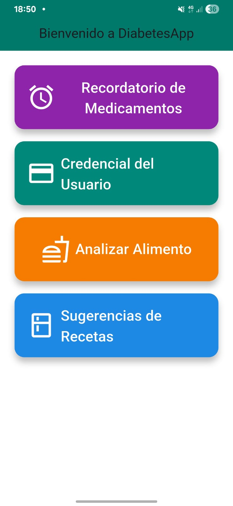
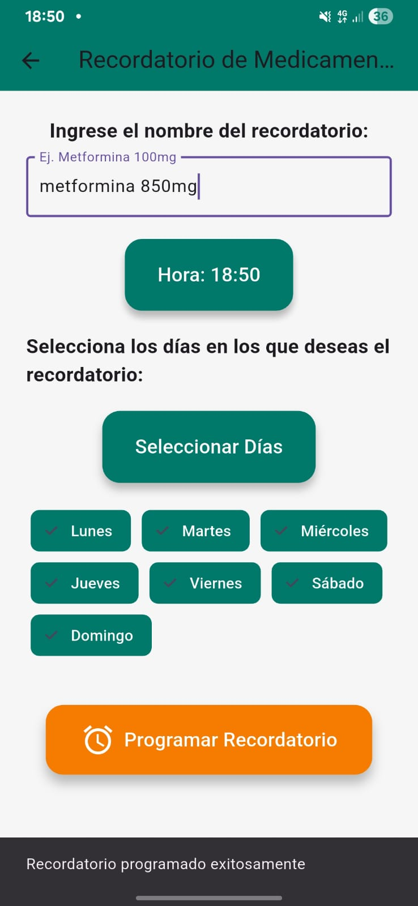
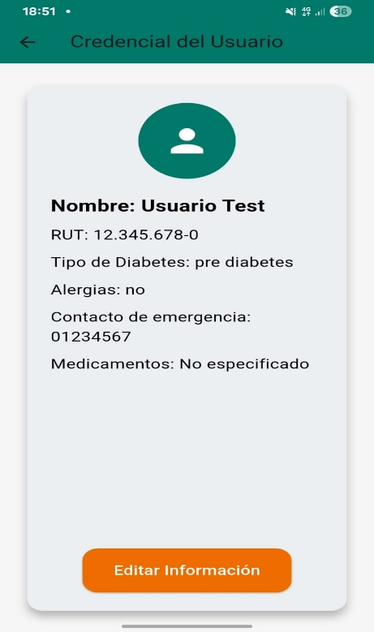
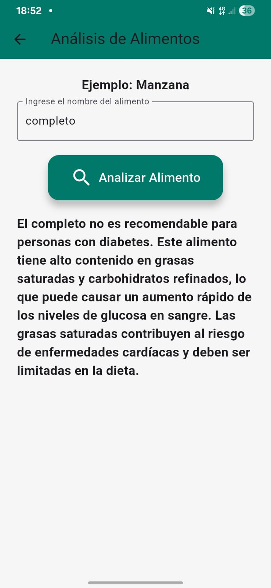
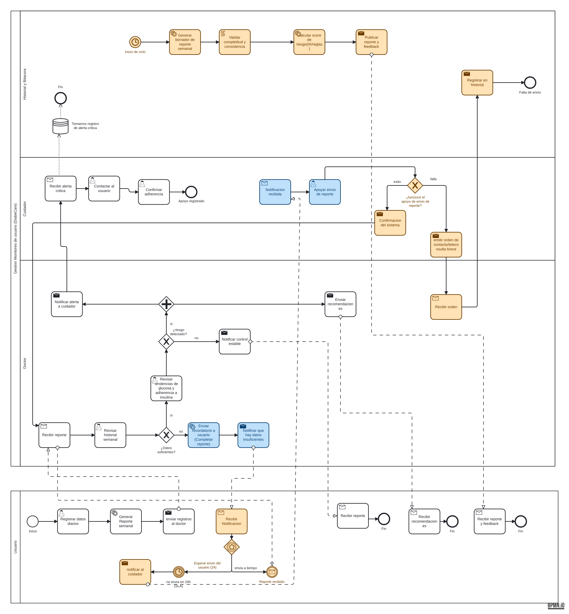
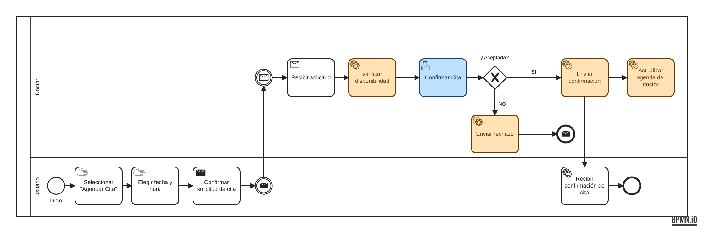
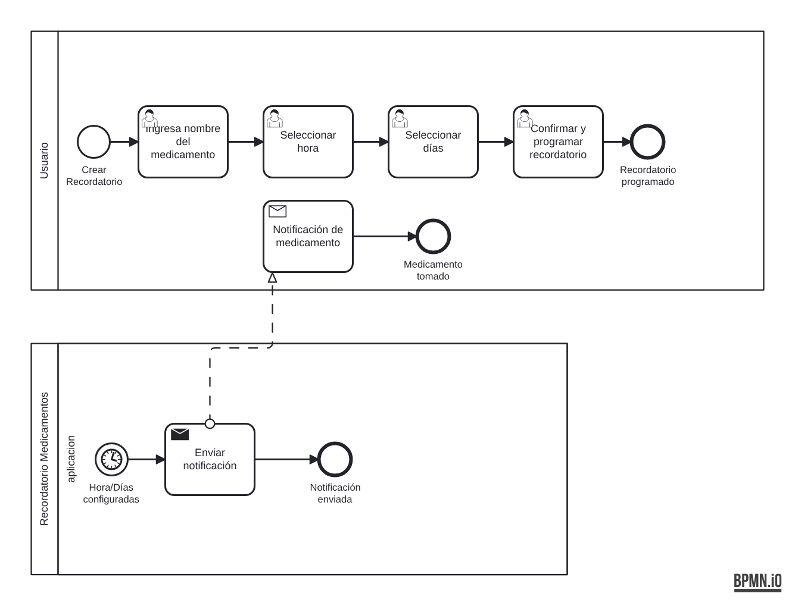
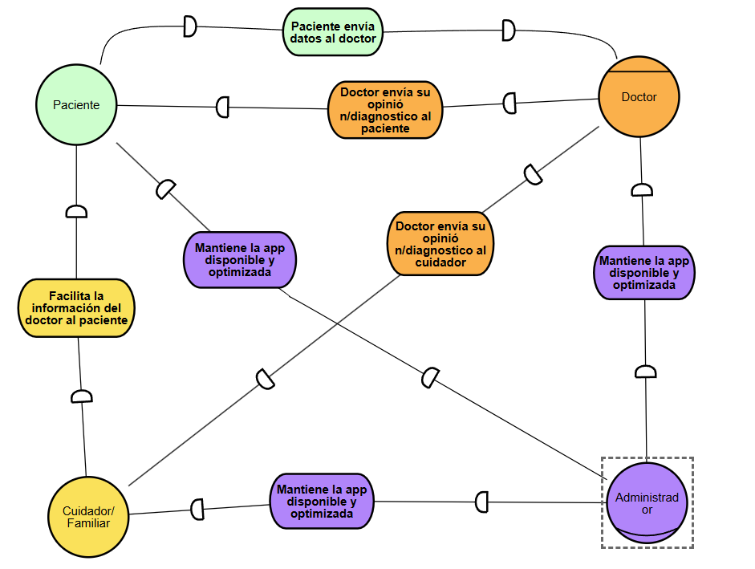
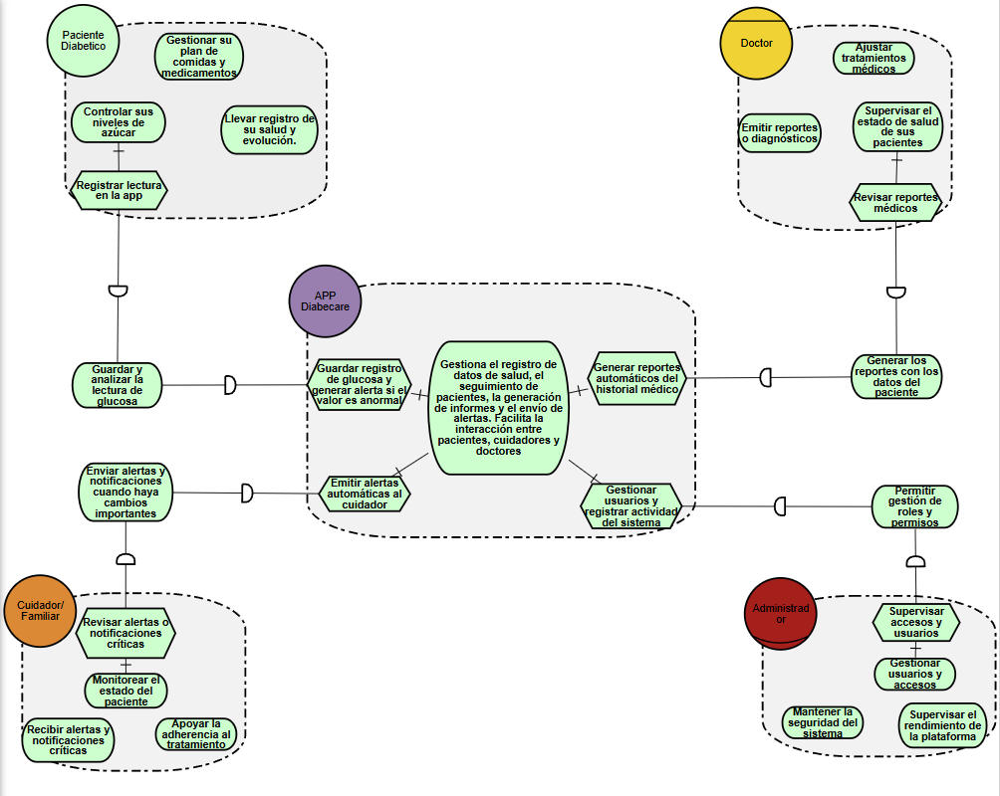

# DiabeCare

Aplicación de apoyo para personas con diabetes: recordatorios de medicamentos, análisis nutricional de alimentos con inteligencia artificial, credencial médica del usuario y seguimiento del paciente por parte de su médico y cuidador.

DiabeCare fue el proyecto grupal que el equipo desarrolló a lo largo de varias asignaturas de Ingeniería Civil Informática en la Universidad de Valparaíso. Cada asignatura abordó una etapa distinta del ciclo de vida del software, desde la definición de requisitos hasta el MVP funcional, el modelado de procesos y el diseño de la experiencia de usuario.

| Etapa | Asignatura | Entregables |
|---|---|---|
| Requisitos, arquitectura y MVP | Fundamentos de Ingeniería de Software (2025) | Requisitos, arquitectura en capas, historia de usuario, MVP en Flutter y Flask, pruebas funcionales |
| Modelado de procesos y requerimientos | Metodologías de Análisis y de Diseño | Diagramas BPMN, modelos iStar, especificación de caso de uso |
| Arquitectura de información | Interacción Persona-Computador | Card sorting, mapa de contenido, wireframes y wireflow |

**Equipo:** Cristóbal Soto, Alonso Venegas, Maximiliano Rozas, Pablo Medina, Simón Canales.

---

## 1. Requisitos, arquitectura y MVP

### Problema y objetivo

Las personas con diabetes suelen olvidar registrar sus mediciones y tomar sus medicamentos, y no reciben retroalimentación clara sobre cómo su alimentación afecta su glucosa. DiabeCare busca mejorar la adherencia al tratamiento y el autocontrol del paciente.

### Proceso de desarrollo

Se adoptó Scrum por su enfoque iterativo e incremental: permitía entregar un prototipo funcional temprano y priorizar las funciones críticas (recordatorios y análisis de alimentos) antes que las complementarias (planificador de comidas y calculadora de gastos). La planificación y el control de avance se llevaron mediante reuniones periódicas con minutas.

### Requisitos principales

- **Funcionales:** registro del perfil médico del usuario, recordatorios programados de medicamentos, análisis nutricional de alimentos, historial de comidas y glucosa, planificador semanal de comidas y calculadora de costos de insumos.
- **No funcionales:** interfaz accesible para adultos mayores, tiempos de respuesta bajos en las consultas a la IA, confidencialidad de los datos médicos (cifrado en tránsito y en reposo) y escalabilidad para integrar dispositivos IoT de monitoreo de glucosa.

### Arquitectura del MVP

| Capa | Tecnología | Propósito |
|---|---|---|
| Frontend móvil | Flutter | Interfaz Android, navegación y formularios |
| Backend / IA | Python, Flask | Servicio que clasifica si un alimento es apto para personas con diabetes |
| Datos nutricionales | OpenFoodFacts | Información nutricional y códigos de barras |
| Despliegue | Render | Hosting del servicio Flask |

### Historia de usuario implementada

> Como persona con diabetes, quiero consultar en cualquier momento la información nutricional de un alimento desde mi celular, para saber si es saludable para mi condición y tomar decisiones informadas sobre mi alimentación.

### Pruebas funcionales

Se probó el MVP en un dispositivo Android (Samsung A32, Android 14) y en el emulador de Flutter, con productos de consumo habitual en Chile.

| Producto | Condición | Esperado | Obtenido | Resultado |
|---|---|---|---|---|
| Super 8 | Con internet | No apto | No apto | OK |
| Manzana | Con internet | Apto | Apto | OK |
| Producto inexistente | Con internet | "No encontrado" | "No encontrado" | OK |
| Yogur natural | Sin internet | Apto | Apto | OK |

### Capturas del MVP

| Inicio | Recordatorio de medicamentos | Credencial del usuario | Análisis de alimento |
|---|---|---|---|
|  |  |  |  |

Las capturas usan datos de prueba ficticios.

Informe completo: [informe-mvp-diabecare.pdf](documentos/informe-mvp-diabecare.pdf)

---

## 2. Modelado de procesos y requerimientos

### Diagramas BPMN

**Monitoreo del paciente.** Modela el ciclo semanal de seguimiento: el paciente registra sus datos diarios, el sistema genera un reporte, valida su completitud y calcula un puntaje de riesgo, y el médico revisa tendencias de glucosa y adherencia. Incluye un plazo de 24 horas (SLA) para el envío del reporte, la notificación al cuidador si el paciente no cumple, alertas críticas cuando se detecta riesgo y el registro de todo en una bitácora.

**Agendar cita médica.** El usuario solicita una hora, el sistema verifica la disponibilidad del médico y este acepta o rechaza la cita. Si la acepta, se actualiza su agenda.

**Recordatorio de medicamentos.** El usuario configura el medicamento, la hora y los días, y la aplicación envía la notificación en el momento programado.

### Modelos iStar

Modelado orientado a objetivos de los actores del sistema (paciente, cuidador, médico, administrador y la aplicación), con sus metas, tareas y dependencias.

| Dependencia estratégica | Racionalidad estratégica |
|---|---|
|  |  |

### Especificación de caso de uso

Especificación detallada del caso de uso "Monitoreo de Paciente": actores, precondiciones y postcondiciones, flujo principal de 11 pasos, flujos alternativos (reporte fuera de plazo, datos insuficientes, riesgo detectado, adherencia no confirmada), requerimientos funcionales y no funcionales, excepciones y modelo de dominio.

Documento: [especificacion-caso-uso-monitoreo.pdf](documentos/especificacion-caso-uso-monitoreo.pdf)

---

## 3. Arquitectura de información

Para definir la estructura de navegación de la aplicación se realizó un **card sorting abierto**, con una sesión grupal en Miro y un estudio online en Optimal Workshop. Participaron perfiles representativos de los usuarios: un paciente con diabetes tipo 1, cuidadores de pacientes y personal de salud. Ordenaron las 9 funciones principales de la aplicación en las categorías que les parecieron más naturales.

Los participantes formaron de manera consistente tres grupos, que pasaron a ser las ramas principales del mapa de contenido:

- **Gestión de salud:** medicación, recordatorios, gráficos de glucosa y recomendaciones alimentarias. Es el núcleo de la aplicación.
- **Soporte y comunicación:** contacto con el médico.
- **Configuración y perfil:** inicio de sesión y perfil del usuario.

Con esa estructura se diseñaron wireframes de baja fidelidad y un wireflow del recorrido principal: inicio de sesión, inicio, registro de muestra, historial, gráficos y perfil. La pantalla de registro de muestra se diseñó para completarse en menos de 30 segundos.

---

## Archivos fuente

Los diagramas se pueden abrir y editar:

- `fuentes/*.bpmn`: en [bpmn.io](https://demo.bpmn.io) o Camunda Modeler.
- `fuentes/istar-*.json`: en [piStar](https://www.cin.ufpe.br/~jhcp/pistar/).
